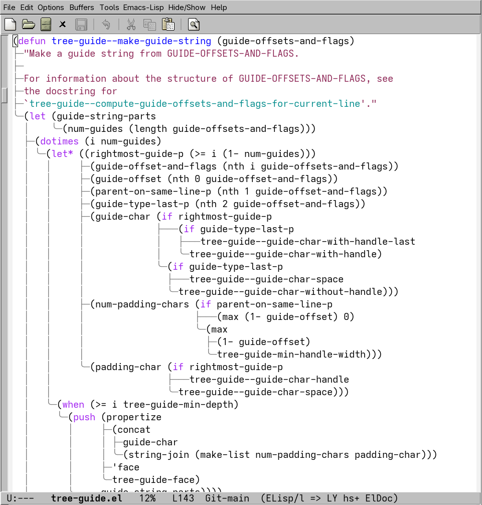
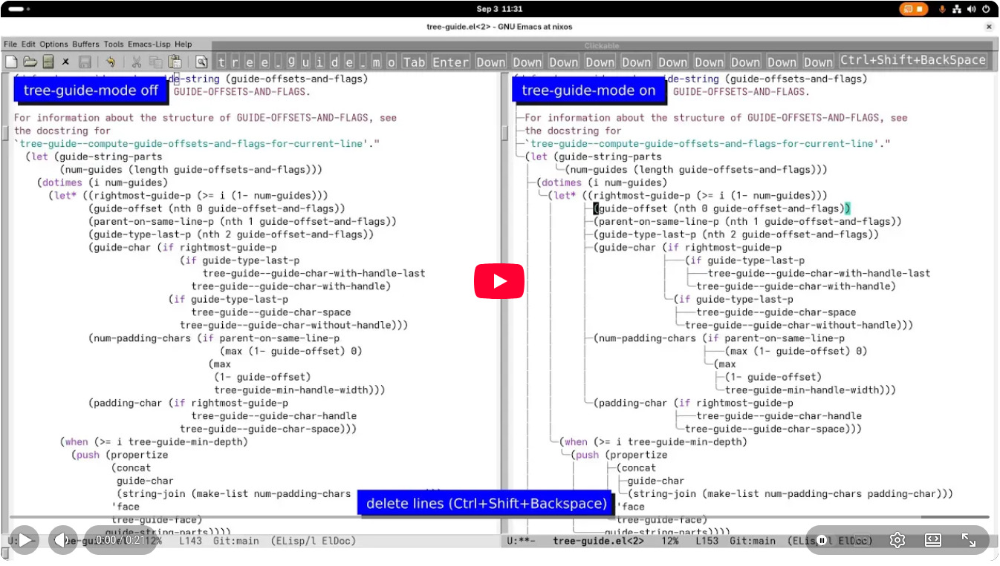
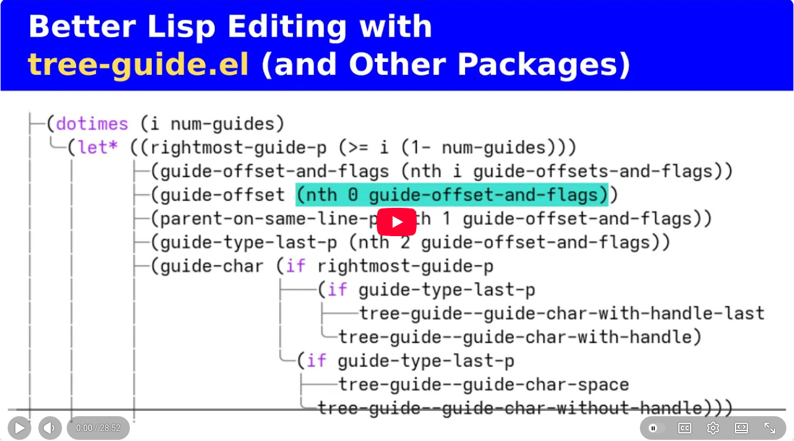

> [!NOTE]
>
> `tree-guide.el` is _sponsorware_, which means that [my sponsors](https://github.com/sponsors/benvvalk) get early access to the next version of `tree-guide.el`, when it becomes available.
>
> My sponsors also get the ability to [vote on GitHub Issues](https://sponsoredissues.org/benvvalk).
>
> See [my GitHub Sponsors page](https://github.com/sponsors/benvvalk) for further details.

# Table of Contents

* [Description](#description)

* [Screenshots and Videos](#screenshots-and-videos)

* [Features & Caveats](#features-caveats)

* [Installation](#installation)

* [How it Works](#how-it-works)

## Description

`tree-guide-mode` is a local minor mode that renders extra guide lines in lisp source code buffers, as a visual aid for reading the parent-child structure of the code. All of your editing commands continue to work as expected, and the guides update in real time as you edit.

## Screenshots and Videos

Screenshot:



Short editing demo (20 seconds, no audio):

[](https://www.youtube.com/watch?v=cmi_VjZnHX4l)

Full demo and lisp editing tutorial (~ 30 mins, narrated):

[](https://www.youtube.com/watch?v=5qgXUH5pHOk)

## Features & Caveats

Features:

* local minor mode, easily toggled on/off with `M-x tree-guide-mode`
* guides update in real time while editing the code
* integrates well with structural editing packages (e.g. `lispy`)
* performs well on large files
* no dependencies (uses Emacs' built-in lisp-parsing functions)

Caveats:

* more difficult to see/fix code indentation issues (I recommend using [aggressive-indent-mode](https://github.com/Malabarba/aggressive-indent-mode) for that)
* flickering during guide updates might be annoying
* only tested with elisp code so far

## Installation

`tree-guide.el` is not on MELPA yet. In the meantime, you will need to manually `git clone` the repo:

```bash
mkdir -p ~/git
cd ~/git
git clone https://github.com/benvvalk/tree-guide.el.git
```

And then add the `git clone` directory to your elisp load path in your `init.el`, e.g.:

```elisp
(use-package tree-guide
  ;; add `git clone` directory to elisp load path
  :load-path "~/git/tree-guide.el/"
  ;; optional: automatically enable `tree-guide-mode` in *.el files
  :hook emacs-lisp-mode)
```

## How it Works

To determine the structure of the lisp parse tree, `tree-guide-mode` uses Emacs' built-in [syntax-ppss](https://www.gnu.org/software/emacs/manual/html_node/elisp/Parser-State.html) function. Among other info, `syntax-ppss` returns the start position of the parent expression surrounding POINT, e.g. the position of the open paren ("`(`") for the list containing POINT. `tree-guide-mode` uses this information to walk up the lisp parse tree, by recursively moving POINT to the start position returned by `syntax-ppss` and calling `syntax-ppss` again, until the root of lisp parse tree is reached. (This traversal is implemented in `tree-guide--compute-guide-offsets-and-flags-for-current-line`.)

To display the tree guide characters, `tree-guide-mode` uses an Emacs feature called [overlays](https://www.gnu.org/software/emacs/manual/html_node/elisp/Overlays.html), which provides the ability to display "virtual" characters in the buffer, i.e. characters which do not actually exist in the underlying buffer text. Interestingly, overlays also provide the ability to _hide_ characters in the underlying buffer text, and `tree-guide-mode` makes use of both abilities. For each line in the buffer, `tree-guide-mode` creates two overlays: (1) an overlay to hide the string of leading space/TAB characters at the beginning of the line (real characters), and (2) an overlay to display the guide string (virtual characters, e.g. "`│ ├─`") at the beginning of each line. The function that creates/updates these two overlays for line that contains POINT is `tree-guide--update-or-create-overlays-for-current-line`.

To update the tree guides in reponse to user edits, `tree-guide-mode` uses an [after-change-functions](https://www.gnu.org/software/emacs/manual/html_node/elisp/Change-Hooks.html) hook to record the buffer ranges where text has been edited, and then updates the edited ranges "in the background" (i.e. when the user is not typing) using an [idle timer](https://www.gnu.org/software/emacs/manual/html_node/elisp/Idle-Timers.html). To make the update algorithm as easy-to-understand as possible, the  update logic is line-based. When `tree-guide-mode` updates the guide overlays for an edited buffer range, it first updates the lines directly overlapping the edited range, and then it incrementally expands the updates to include lines before and after the edited range, until it sees a line where the guide overlay is already up-to-date (i.e. the newly computed guide string is identical to the existing guide string). The update algorithm needs to consider lines before and after the edited buffer range because buffer edits can have arbitrarily far-reaching effects on the lisp parse tree, and it is difficult to predict exactly which lines will be affected. For example, inserting a single open paren character ("`(`") at the beginning of a buffer will increase the nesting level of every lisp expression that follows it, and will therefore require updating the guide overlays on every line in the buffer (!). Such large updates do not pose a problem in terms of performance/responsiveness, because the guide overlays are updated incrementally using an idle timer, and on-screen lines are always updated before off-screen lines.